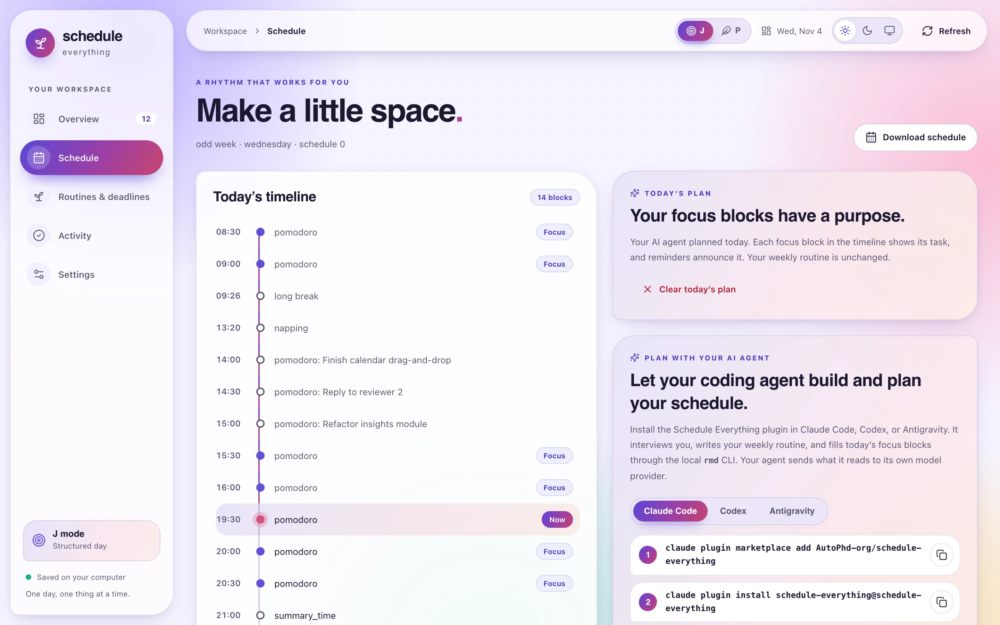
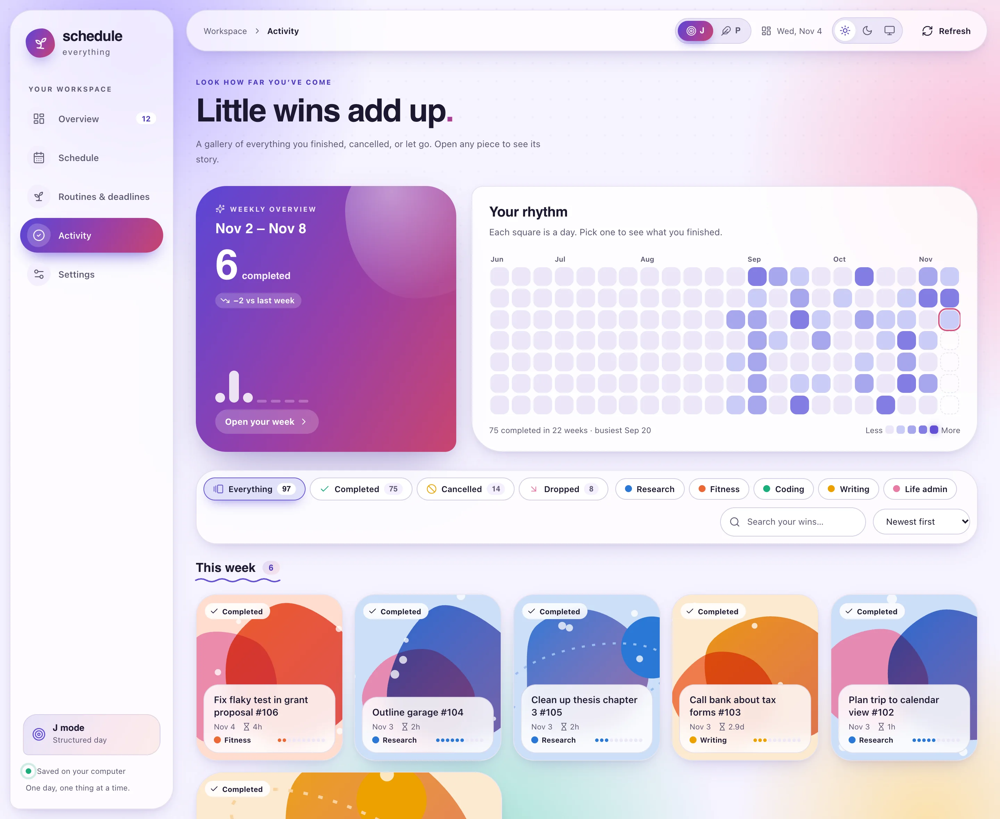
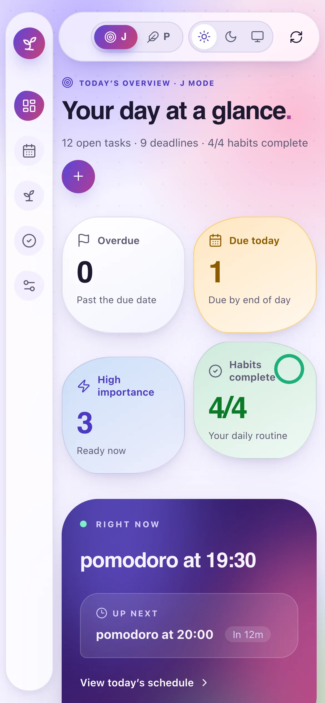
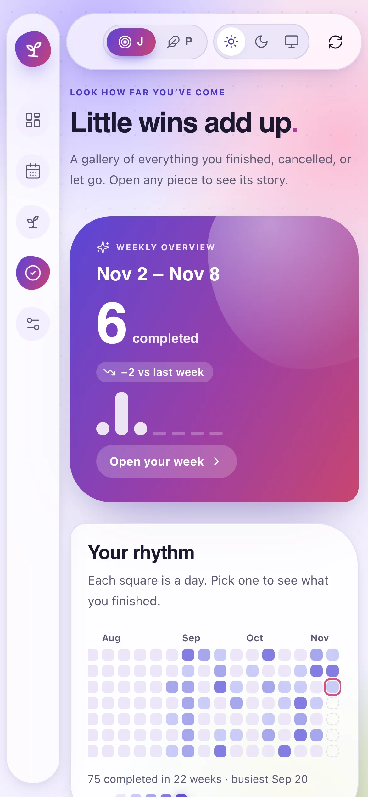
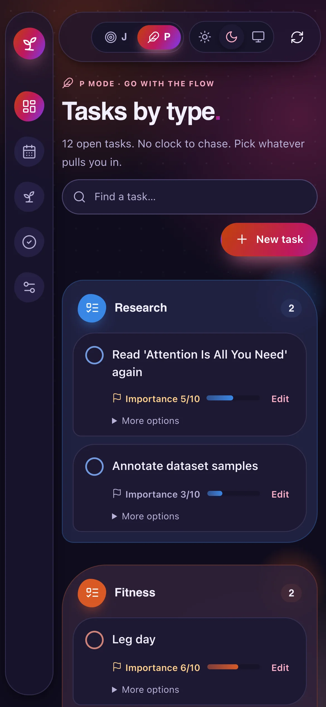

Last December I wrote about a small Python daemon that nagged me through the day. The idea behind it still holds: if your schedule is a set of plain files, you can automate the boring parts without giving up control. Almost everything else has been rebuilt. **[Schedule Everything](https://github.com/AutoPhd-org/schedule-everything)** is now one Rust binary called `rmd`, it has a browser workspace, and the most tedious part of planning, turning a messy week into a schedule, is something I now hand to my AI agent. This is the post rewritten to match.
{.lead}

## The problems haven't changed

Last time I listed what kept going wrong when I tried to plan. Every item is still true, so here is the same list next to what the tool does about each one today.

| What kept going wrong | What Schedule Everything does now |
| --- | --- |
| Too many deadlines and small tasks to remember | Tasks with an importance from 1 to 10, deadlines on a year calendar, and fixed times each day when urgent work is checked and announced |
| Deciding what to do next instead of doing it | My agent assigns tasks to today's focus blocks, and the alarm at the start of each block says which task it is for |
| Planned versus actual progress | Everything I finish, cancel, or give up lands in **Activity**, and weekly and monthly reports summarise it |
| Unexpected work wrecking the whole plan | A plan only ever changes *today*, and **P mode** turns the day into a task board without the clock |
| Unfinished tasks piling up until I abandon the system | A **workload** number that shows how heavy the pile really is, postponement, and an honest way to give up on a task |

I also wanted three things. Habit tracking is a `habits.toml` file, `rmd track`, and a check-in prompt every night. Reviews are a weekly overview in the browser plus PDF reports that generate themselves on Sunday evening and on the first of the month. And the reminders are still the kind you can't swipe away: a sound that repeats every few seconds and a dialog that stays up until you answer it.

## What changed in a year








The Python implementation is gone. Before I deleted it, I recorded its behaviour as golden test cases (CLI output, browser API responses, and the data files it writes), and the Rust port replays them on every `cargo test`.So the rewrite isn't "inspired by" the old tool; it is checked against it, down to the column widths of the task table. Everything stays local: the routine is TOML, tasks and history are JSON, and there is no account and no server.

## How it works now


{.wide}

The most important design decision is the split of labour. The agent plugin's skills ask questions and make judgment calls. `rmd` does the parts that must be exactly right: `rmd check` validates a configuration and reports where its files live, `rmd sync --json` describes today's focus blocks and open tasks, and `rmd sync --apply` saves a plan. The reminder service, started at login, checks the schedule every minute and turns the files into alarms, and `rmd web` shows the same files in a browser.

Here is what happens when I ask for a plan in the morning:

```mermaid {class="wide" caption="The plan-day skill, end to end. The agent proposes; nothing is saved until I agree." alt="Sequence diagram: I ask the agent to plan my day; it reads rmd sync --json, proposes a plan, I adjust it, it saves the plan with rmd sync --apply, and the reminder service announces each block's task."}
sequenceDiagram
    actor Me
    participant Agent as AI agent · plan-day
    participant rmd
    participant Service as Reminder service
    Me->>Agent: Plan my focus blocks for today
    Agent->>rmd: rmd sync --json
    rmd-->>Agent: free slots, open tasks, deadlines
    Agent->>Me: Proposed plan, ordered by time
    Me->>Agent: Swap the 14:00 and 15:00 blocks
    Agent->>rmd: rmd sync --apply -
    rmd->>rmd: save today's plan (an overlay file)
    rmd-->>Service: picked up without a restart
    Service->>Me: 14:00 alarm names the block's task
```

## My week is still a file

The building blocks are the same as last year, and they are still the core of the system. In `settings.toml`, a **time block** is a reusable length of time with an alarm at the start and at the end, and a **time point** is a single reminder with a message:

```toml {title="settings.toml (excerpt)"}
[settings]
alarm_interval = 5          # seconds between repeats of the alarm sound
max_alarm_duration = 300    # stop ringing after five minutes
skip_days = ["sunday"]
language = "en"             # also "zh", "es", or "ko"

[time_blocks]               # minutes
pomodoro = 25
potato = 50
meeting = 50

[time_points]               # one reminder each
lunch_time = "Lunch 🍱"
go_to_bed = "Time for bed 😴"

[tasks]                     # fixed daily checks and reviews
daily_urgent = ["08:31", "14:01", "17:31", "21:31"]
ddl_urgent = ["08:32", "14:02", "17:32", "22:32"]
habit_prompt = "23:50"
weekly_review = "sunday 20:00"
```

The week lives in two files, `odd_weeks.toml` and `even_weeks.toml`, picked by ISO week number so that alternating timetables just work. A `[common]` section applies to every day, and a weekday entry at the same time wins. A block can carry its own title:

```toml {title="odd_weeks.toml"}
[wednesday]
"09:00" = "pomodoro"                                  # alarms at 09:00 and 09:25
"14:00" = { block = "meeting", title = "Advisor 1:1" }

[common]                                              # every day
"12:30" = "lunch_time"
"20:00" = "potato"
```

Untitled `pomodoro` and `potato` blocksIn my config a *potato* is a 50-minute block, the pomodoro's bigger sibling. are the interesting ones: they are focus slots, and a daily plan fills them with real tasks. The plan is an overlay for today only. My weekly files never change.


{.wide}

Put together, a Tuesday from the template configuration looks like this, with three blocks planned:


08:30-09:20 | potato | open blocks
09:30-10:20 | potato | open blocks
10:30-11:20 | potato | open blocks
11:30-12:20 | potato | open blocks
14:00-14:50 | Rerun the OSWorld ablation | planned
15:00-15:50 | Draft the related-work section | planned
16:00-16:50 | potato | open blocks
17:00-17:50 | potato | open blocks
19:30-20:20 | Leg day | planned
20:30-20:55 | pomodoro | open blocks
21:30-21:55 | pomodoro | open blocks
13:20 | Nap time | reminders
23:45 | Wrap up the day | reminders
23:55 | Time for bed | reminders
08:31 | Urgent tasks | checks
14:01 | Urgent tasks | checks
17:31 | Urgent tasks | checks
21:31 | Urgent tasks | checks
08:32 | Deadlines | checks
14:02 | Deadlines | checks
17:32 | Deadlines | checks
22:32 | Deadlines | checks
23:35 | Daily summary | checks
23:50 | Habit check-in | checks


Every change to the routine becomes a new version. The config root holds `user_config_0`, `user_config_1`, and so on, and `rmd switch <n>` activates one and reloads the reminders. Earlier versions stay put.

> [!TIP] Rolling back a bad week
> Because a change never edits the active version in place, undoing it is one command: `rmd switch` with the previous version's number.

## Letting the agent write it

The slowest part of last year's setup was the first hour: translating a course timetable, a few fixed meetings, and some vague intentions about exercise into TOML. That hour is now a conversation. The `schedule-everything` plugin works in Claude Code, OpenAI Codex, and Google Antigravity:



```bash
claude plugin marketplace add AutoPhd-org/schedule-everything
claude plugin install schedule-everything@schedule-everything
```


```bash
codex plugin marketplace add AutoPhd-org/schedule-everything
codex plugin add schedule-everything@schedule-everything
```


```bash
git clone https://github.com/AutoPhd-org/schedule-everything.git
agy plugin install ./schedule-everything/plugins/schedule-everything
```



Saying "build my weekly schedule" starts the `build-schedule` skill:


1. **It finds my files.** `rmd check --json` reports the config root, the active version, and which files exist.
2. **It interviews me.** Wake and sleep times, fixed obligations, goals, habits, when I focus best, and whether odd and even weeks differ. The answers go into `profile.md`. If I hand it a timetable file or a screenshot, it reads that and only asks about what is unclear.
3. **It shows me the week in plain language** and waits for my confirmation before writing anything.
4. **It writes and checks.** It writes `settings.toml`, both week files, `habits.toml`, and `profile.md`, validates them with `rmd check`, and reloads the reminders. Changing an existing schedule creates a new version instead of editing the active one.



When my answers leave gaps, the skill protects a few evidence-informed defaults: at least 7 hours of sleep opportunity with regular sleep and wake times, 150–300 minutes of moderate activity a week with strength work on two or more days, short movement breaks in long sedentary stretches, demanding work in my best-focus window, and daylight early in the day. They are scheduling heuristics, not medical advice, and my real constraints always win.

Sources: the [AASM consensus on adult sleep](https://aasm.org/resources/pdf/pressroom/adult-sleep-duration-consensus.pdf); Sletten et al., [*The importance of sleep regularity*](https://doi.org/10.1016/j.sleh.2023.07.016); the [WHO physical activity recommendations](https://www.who.int/initiatives/behealthy/physical-activity); Albulescu et al., [*"Give me a break!"*](https://journals.plos.org/plosone/article?id=10.1371/journal.pone.0272460); and Figueiro et al., [*daytime light exposure in office workers*](https://doi.org/10.1016/j.sleh.2017.03.005).


The daily loop is where the agent earns its keep. "Plan my focus blocks for today" runs `plan-day`, which reads today's free blocks, my open tasks, and the nearest deadlines, matches the important work to the blocks, and saves the plan once I agree. Underneath, it is three commands I could type myself:


$ rmd sync --json | head -12
{
  "date": "2026-11-10",
  "weekday": "tuesday",
  "parity": "even",
  "mode": "j",
  "skipped": false,
  "slots": [
    {
      "time": "08:30",
      "block": "potato",
      "minutes": 50,
      "title": null
$ rmd sync --apply plan.json
Saved today's plan with 3 focus blocks to ~/.schedule_management/config/synced_schedule.toml.
$ rmd sync
                Today's focus blocks
╭───────┬──────────┬────────────────────────────────╮
│  Time │ Block    │ Planned task                   │
├───────┼──────────┼────────────────────────────────┤
│ 08:30 │ potato   │ —                              │
│ 09:30 │ potato   │ —                              │
│ 10:30 │ potato   │ —                              │
│ 11:30 │ potato   │ —                              │
│ 14:00 │ potato   │ Rerun the OSWorld ablation     │
│ 15:00 │ potato   │ Draft the related-work section │
│ 16:00 │ potato   │ —                              │
│ 17:00 │ potato   │ —                              │
│ 19:30 │ potato   │ Leg day                        │
│ 20:30 │ pomodoro │ —                              │
│ 21:30 │ pomodoro │ —                              │
╰───────┴──────────┴────────────────────────────────╯


The plan itself is tiny. Keys are today's slot times, a partial plan is fine, and applying a new one replaces the old:

```json {title="plan.json"}
{
  "date": "2026-11-10",
  "assignments": {
    "14:00": "Rerun the OSWorld ablation",
    "15:00": "Draft the related-work section",
    "19:30": "Leg day"
  }
}
```

The third skill, `suggest-tasks`, reads my connected apps (email, calendar, documents, issue trackers) for work I haven't captured yet: a request waiting for a reply, a form with a date on it, a talk to prepare. It runs well as a scheduled routine every weekday morning.

> [!IMPORTANT] Suggestions are not tasks
> The agent never adds a task itself. Its suggestions wait on the task board, dashed and labelled with who suggested them and why, until I click **Add to my tasks** or **Reject**. No reminder, count, or statistic includes them. It only reads my apps, treats what it reads as data (an email cannot instruct it), won't re-suggest something I rejected in the last 60 days, and can't have more than 20 suggestions waiting at once.

## Reminders that stick

This is the part I refused to compromise on, and it has barely changed. At the start and end of every block, the service plays a sound every `alarm_interval` seconds and keeps a dialog open until I respond, for up to `max_alarm_duration`. With the template settings, it checks for urgent tasks four times a day, checks for deadlines that are getting close four more times, and asks about habits at night.

Tasks and deadlines are still a few keystrokes away. This is real output, from a fresh config:


$ rmd add "Rerun the OSWorld ablation" 9 3
✅ Task 'Rerun the OSWorld ablation' added successfully with priority 9!
$ rmd add "Draft the related-work section" 8 1
✅ Task 'Draft the related-work section' added successfully with priority 8!
# …and two more the same way
$ rmd ls
                                   Current Task List
╭──────────┬─────────────────────────┬─────────────────────────────────────────────────╮
│       ID │ Priority                │ Description                                     │
├──────────┼─────────────────────────┼─────────────────────────────────────────────────┤
│        1 │ █████████░ (9)          │ Rerun the OSWorld ablation                      │
│        2 │ ████████░░ (8)          │ Draft the related-work section                  │
│        3 │ ██████░░░░ (6)          │ Leg day                                         │
│        4 │ █████░░░░░ (5)          │ Review lab PR                                   │
╰──────────┴─────────────────────────┴─────────────────────────────────────────────────╯
■ read papers  ■ gym work  ■ coding  ■ other
$ rmd ddl add "Rebuttal due" 11.21
✅ Deadline 'Rebuttal due' added successfully for 2026-11-21!
$ rmd ddl add "Group meeting slides" 11.12 --repeat weekly
✅ Deadline 'Group meeting slides' added successfully for 2026-11-12!
$ rmd ddl
                                   Current Deadlines
╭───────────────────────────────────┬───────────────────┬────────────────┬─────────────╮
│ Event                             │ Deadline          │      Days Left │   Status    │
├───────────────────────────────────┼───────────────────┼────────────────┼─────────────┤
│ Group meeting slides ↻ Weekly     │ Nov 12, 2026      │    2 days left │  🔴 URGENT  │
│ Rebuttal due                      │ Nov 21, 2026      │   11 days left │    🟢 OK    │
╰───────────────────────────────────┴───────────────────┴────────────────┴─────────────╯


One small but useful change: there are now three ways to take a task off the list, and they mean different things in the history.

| Command | Use it when | Counts as done? |
| --- | --- | --- |
| `rmd rm` | I finished it | Yes |
| `rmd cancel` | I added it by mistake | No |
| `rmd drop` | I decided to give up on it | No |

## J mode and P mode

Not every day deserves a timetable. The **J / P** switch in the workspace header (or `rmd mode j|p`) changes the reminder service and the browser together.The letters borrow the judging/perceiving pair from personality-type jargon: J plans ahead, P keeps options open. J mode is the structured day: status counts, the current and next block, upcoming deadlines, the task board, and the timeline. P mode pauses alarms for selected events and keeps only the tasks, grouped by type. Drag the handle to compare:



## The workspace

`rmd web` opens a local workspace on `127.0.0.1` that reads and writes the same files as the CLI, and only accepts API calls that carry the session token of the tab it opened. It has five pages: **Overview**, **Schedule**, **Routines & deadlines**, **Activity**, and **Settings**, and it speaks English, Chinese, Spanish, and Korean.

### Workload: how heavy is the pile?

The most useful number on the Overview is **workload**. Every open task counts its importance out of 10, times the share of it still left: an importance-8 task counts 0.8 untouched, 0.4 when half done, and nothing when finished. The total falls into one of five levels, and the workspace's colours follow it, from cool greens and blues when the plate is clear to warm oranges and reds when it is heavy. Try it with the four tasks from above:


<style>
  .wl { display: grid; gap: 14px; }
  .wl__rows { display: grid; gap: 8px; }
  .wl__row { display: grid; grid-template-columns: minmax(0, 1.5fr) minmax(0, 1fr) minmax(0, 1fr) 46px; gap: 10px 14px; align-items: center; padding: 10px 12px; border: 1px solid var(--border); border-radius: 10px; background: var(--bg); }
  .wl__name { min-width: 0; font-weight: 500; overflow: hidden; text-overflow: ellipsis; white-space: nowrap; }
  .wl__ctl { display: grid; gap: 2px; font-size: 0.75rem; color: var(--muted); }
  .wl__ctl span { display: flex; justify-content: space-between; }
  .wl__ctl output { color: var(--text); font-weight: 600; font-variant-numeric: tabular-nums; }
  .wl__ctl input { width: 100%; accent-color: var(--accent); }
  .wl__score { text-align: right; font-weight: 700; font-variant-numeric: tabular-nums; color: var(--text-2); }
  .wl__summary { display: flex; flex-wrap: wrap; align-items: baseline; gap: 6px 14px; }
  .wl__total { font-size: 2rem; font-weight: 700; letter-spacing: -0.02em; font-variant-numeric: tabular-nums; color: var(--wl, var(--accent)); }
  .wl__level { padding: 3px 10px; border-radius: 999px; font-weight: 600; font-size: 0.85rem; color: var(--wl, var(--accent)); background: color-mix(in srgb, var(--wl, var(--accent)) 14%, transparent); }
  .wl__hint { color: var(--muted); font-size: 0.85rem; }
  .wl__meter { position: relative; height: 12px; border-radius: 999px; background: linear-gradient(90deg, var(--c-tip) 0 20.8%, var(--series-1) 20.8% 45.8%, var(--c-warning) 45.8% 75%, var(--c-caution) 75% 100%); opacity: 0.9; }
  .wl__needle { position: absolute; top: -5px; width: 4px; height: 22px; margin-left: -2px; border-radius: 2px; background: var(--text); box-shadow: 0 0 0 2px var(--surface); transition: left 0.25s; }
  .wl__scale { position: relative; height: 16px; font-size: 0.7rem; color: var(--faint); }
  .wl__scale span { position: absolute; transform: translateX(-50%); }
  .wl__actions { display: flex; gap: 8px; }
  .wl__actions button { padding: 6px 12px; border: 1px solid var(--border-strong); border-radius: 8px; background: var(--surface); color: var(--text); font: 500 0.82rem/1 var(--font-sans); cursor: pointer; }
  .wl__actions button:hover { border-color: var(--accent); color: var(--accent); }
  @media (max-width: 640px) { .wl__row { grid-template-columns: 1fr 1fr 40px; } .wl__name { grid-column: 1 / -1; } }
</style>
<div class="wl" data-wl>
  <div class="wl__summary">
    <span>Workload</span>
    <strong class="wl__total" data-wl-total>0.0</strong>
    <span class="wl__level" data-wl-level>All clear</span>
    <span class="wl__hint" data-wl-hint></span>
  </div>
  <div>
    <div class="wl__meter" aria-hidden="true"><span class="wl__needle" data-wl-needle></span></div>
    <div class="wl__scale" aria-hidden="true"><span style="left:0%;transform:none">0</span><span style="left:20.8%">2.5</span><span style="left:45.8%">5.5</span><span style="left:75%">9</span><span style="left:100%;transform:translateX(-100%)">12</span></div>
  </div>
  <div class="wl__rows" data-wl-rows></div>
  <div class="wl__actions"><button type="button" data-wl-add>Add a task</button><button type="button" data-wl-reset>Reset</button></div>
</div>
<script>
(function () {
  var root = document.querySelector('[data-wl]');
  if (!root) return;
  var start = [
    ['Rerun the OSWorld ablation', 9, 0],
    ['Draft the related-work section', 8, 50],
    ['Leg day', 6, 0],
    ['Review lab PR', 5, 0]
  ];
  var levels = [
    { max: 0, name: 'All clear', color: 'var(--c-tip)' },
    { max: 2.5, name: 'Light', color: 'var(--c-tip)' },
    { max: 5.5, name: 'Steady', color: 'var(--series-1)' },
    { max: 9, name: 'Busy', color: 'var(--c-warning)' },
    { max: Infinity, name: 'Heavy', color: 'var(--c-caution)' }
  ];
  var rows = root.querySelector('[data-wl-rows]');
  var n = 0;
  function level(total) {
    if (total <= 0) return levels[0];
    for (var i = 1; i < levels.length; i++) if (total < levels[i].max) return levels[i];
    return levels[levels.length - 1];
  }
  function update() {
    var total = 0;
    rows.querySelectorAll('.wl__row').forEach(function (row) {
      var imp = +row.querySelector('[data-imp]').value;
      var prog = +row.querySelector('[data-prog]').value;
      row.querySelector('[data-imp-out]').textContent = imp;
      row.querySelector('[data-prog-out]').textContent = prog + '%';
      var s = imp / 10 * (1 - prog / 100);
      row.querySelector('.wl__score').textContent = s.toFixed(2);
      total += s;
    });
    var lv = level(total);
    root.style.setProperty('--wl', lv.color);
    root.querySelector('[data-wl-total]').textContent = total.toFixed(1);
    root.querySelector('[data-wl-level]').textContent = lv.name;
    root.querySelector('[data-wl-needle]').style.left = Math.min(100, total / 12 * 100) + '%';
    var next = levels.filter(function (l) { return l.max > total && isFinite(l.max) && l.max > 0; })[0];
    root.querySelector('[data-wl-hint]').textContent = next ? (next.max - total).toFixed(1) + ' to ' + levels[levels.indexOf(next) + 1].name : '';
  }
  function add(name, imp, prog) {
    n += 1;
    var row = document.createElement('div');
    row.className = 'wl__row';
    row.innerHTML =
      '<span class="wl__name"></span>' +
      '<label class="wl__ctl"><span>Importance <output data-imp-out></output></span><input type="range" min="1" max="10" step="1" data-imp></label>' +
      '<label class="wl__ctl"><span>Done <output data-prog-out></output></span><input type="range" min="0" max="100" step="5" data-prog></label>' +
      '<span class="wl__score"></span>';
    row.querySelector('.wl__name').textContent = name;
    row.querySelector('[data-imp]').value = imp;
    row.querySelector('[data-prog]').value = prog;
    row.querySelector('[data-imp]').setAttribute('aria-label', 'Importance of ' + name);
    row.querySelector('[data-prog]').setAttribute('aria-label', 'Progress on ' + name);
    rows.appendChild(row);
  }
  function reset() { rows.innerHTML = ''; n = 0; start.forEach(function (t) { add(t[0], t[1], t[2]); }); update(); }
  rows.addEventListener('input', update);
  root.querySelector('[data-wl-add]').addEventListener('click', function () { add('New task ' + (n - start.length + 1), 7, 0); update(); });
  root.querySelector('[data-wl-reset]').addEventListener('click', reset);
  reset();
})();
</script>


The board itself groups tasks by type. Each task can have a finish-by time, a progress slider, or a checklist of subtasks, and dials above the board count down to whatever is due tonight. A **Glossary** page explains every number the workspace shows, with the formula, an example, and my own current value.

### Schedule, deadlines, and the year


{.wide}

**Routines & deadlines** puts every deadline on a year calendar. Deadlines can repeat weekly, every two weeks, or monthly, get one of eight marker colours, and move by dragging their chip to another day. There is also a switch that adds submission deadlines, rebuttal periods, and conference dates for NeurIPS, ICLR, ICML, CVPR, ACL, ICRA, and other major venues, in my time zone. If your year is organised around conference deadlines, that switch saves a lot of copying.



### Activity: little wins add up

Everything I finish, cancel, or drop grows along a timeline tree, one lane and colour per task type. There is a gallery view with generated artwork for each finished task, a rhythm grid of completions per day, and a weekly overview that compares this week with last week and my recent average. That overview follows this page's theme: toggle dark mode at the top to see both versions.


{.wide}



### Plugins for things that need more than a list

A workspace plugin is a task category with its own page and tracking. The built-in **Fitness** plugin has a body figure that shades each muscle by how many sets worked it this week, a workout builder, a live session with a rest timer, personal records, and body weight. Custom trackers cover practice time, new words, pages read, or anything else, each with weekly goals. A plugin is only visible to my AI agent if I switch that on, in which case `suggest-tasks` can propose, say, a leg workout when my legs have rested for a week.

### On my phone, too

`rmd web --phone` prints a pairing code. Scanning it lets my phone use the workspace on my computer: same tasks, same plan, nothing copied or synced. It works on the same Wi-Fi, or from anywhere over Tailscale.









> [!WARNING]
> With phone access on, the workspace also listens on your local network, and the link travels unencrypted over it. Use it on networks you trust or over Tailscale, and turn it off with `rmd web --no-phone`, which also signs every phone out.

## Principles, revised

Last year's list held up, with a few additions from a year of living with it:

1. **Make every task small and specific.** "Refine the introduction of the report", not "work on the report". A planned block's title is capped at 120 characters, which turns out to be a useful constraint.
2. **Separate what has a time from what doesn't.** If something must happen at a time, it gets a block, a time point, or a deadline, and therefore an alarm. Everything else waits on the board for a focus block.
3. **Let something outside your head nag you, and make it hard to dismiss.** A notification I can swipe away is a suggestion. A dialog that keeps ringing is a commitment.
4. **Let the agent propose; keep the decision.** `build-schedule` waits for my confirmation before writing a file, and suggestions wait until I accept them. Planning got cheaper without my week being decided for me.
5. **Make progress visible.** A streak and a growing timeline are more motivating than a shorter list.
6. **Be honest in the log.** Finished, cancelled, and dropped are different things, and the statistics only mean something if I record which one happened.
7. **Anything at importance 8 or above gets done before tomorrow.** Still my one hard rule.
8. **Sleep beats one more block.** The agent's defaults put sleep first, and so should I.

## Try it

You need [Rust](https://rustup.rs) installed, because the installer builds `rmd` from source (the first build takes a few minutes):


$ curl -fsSL https://raw.githubusercontent.com/AutoPhd-org/schedule-everything/main/install.sh | bash
$ rmd check
$ rmd web


The installer puts `rmd` in `~/SCHEDULE_MANAGEMENT`, creates the config root in `~/.schedule_management/config` with a first `user_config_0`, and registers the reminder service as a LaunchAgent on macOS or a systemd user service on Linux. It never overwrites existing configuration, so running it again is also how you update. Then add the plugin to your agent and say "build my weekly schedule". The [documentation](https://autophd-org.github.io/schedule-everything/) covers the rest.

***

Last year I ended with "your schedule is code". It still is. What changed is who writes most of it: I describe my week, the agent writes the TOML, `rmd check` keeps it honest, and an alarm that won't go away makes sure I actually show up.
