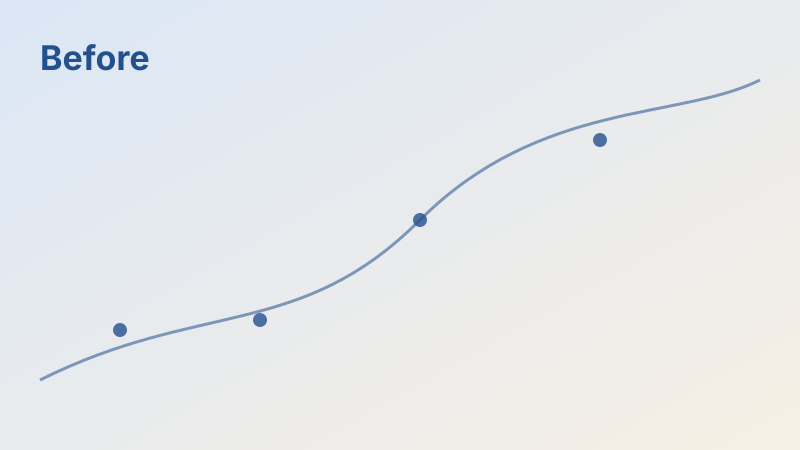
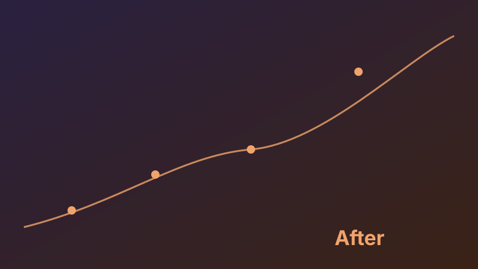

This page is a draft, so it never ships. Run `hugo server -D` and open it to see how each component looks in both themes. Everything here is plain Markdown plus a few shortcodes; the source of this page is the reference.
{.lead}

## Text

A paragraph followed by `{.lead}` on the next line becomes a lead paragraph, like the one above. Inline extras: <mark>highlights</mark>, keys like <kbd>⌘</kbd> <kbd>K</kbd>, footnotes,[^1] and margin notes.On wide screens this sits in the right margin; on phones, tap the number to open it inline. An unnumbered margin note works too.Use `numbered="false"` for asides that don't need a number.

[^1]: Footnotes collect at the end of the post.

> Research is what I'm doing when I don't know what I'm doing.
{.pull}

A blockquote with `{.pull}` on the next line becomes a pull quote. A normal blockquote:

> Plain quotes look like this.

***

Three asterisks make a section break.

## Math

Inline math uses `$...$` or `\(...\)`: the state update is $\mathbf{S}_t = \mathbf{S}_{t-1} + \mathbf{k}_t^\top \mathbf{v}_t$. Display math uses `$$...$$`, and it is rendered at build time, so there is no flicker:

$$
\operatorname{Attn}(\mathbf{q}_t) = \frac{\sum_{i \le t} \exp(\mathbf{q}_t \mathbf{k}_i^\top)\, \mathbf{v}_i}{\sum_{i \le t} \exp(\mathbf{q}_t \mathbf{k}_i^\top)}
$$

## Callouts

GitHub-style alerts are the quickest:

> [!NOTE]
> `> [!NOTE]`, `[!TIP]`, `[!IMPORTANT]`, `[!WARNING]`, and `[!CAUTION]` all work.

> [!TIP] A custom title
> Put text after the marker to replace the title.

> [!WARNING]- Collapsed by default
> Add `-` after the marker to make it collapsible (or `+` to start open).

The `callout` shortcode adds a few more types (`success`, `question`, `example`):


Markdown works **inside**, including lists:

- one
- two



Without a title, the type name is used.


## Figures

A standalone image becomes a figure; the title in quotes is its caption, and you can click to zoom:



Add `{.wide}` on the next line to let it spill into the margin, `{.full}` for full bleed, or `{.narrow}`:


{.wide}

The `figure` shortcode adds a dark-mode variant, a maximum width, and links:



### Gallery






### Before and after



## Diagrams and charts

A fenced block tagged `mermaid` becomes a diagram that follows the theme:

```mermaid {caption="A flowchart. Sequence, state, class, Gantt, and timeline diagrams work too."}
flowchart LR
    A[Read paper] --> B{Worth reproducing?}
    B -- yes --> C[Write code]
    B -- no --> D[Take notes]
    C --> E[Run ablation]
    E --> F((Write it up))
    D --> F
```

A fenced block tagged `chart` holds a [Chart.js](https://www.chartjs.org/docs/latest/) config as JSON. Colours default to the site palette:

```chart {caption="OSWorld success rate (%) from the VLAA-GUI abstract." height="260"}
{
  "type": "bar",
  "data": {
    "labels": ["Human", "VLAA-GUI (best backbone)"],
    "datasets": [{ "label": "OSWorld success rate", "data": [72.4, 77.5] }]
  },
  "options": {
    "indexAxis": "y",
    "plugins": { "legend": { "display": false } },
    "scales": { "x": { "min": 0, "max": 100 } }
  }
}
```

A day or a project laid out in time:


09:00-11:30 | Writing | deep work
14:00-16:00 | Experiments | deep work
12:00 | Lunch | breaks
16:00-16:15 | Walk | breaks
11:30-12:00 | Group meeting | meetings
17:00-17:30 | Advisor 1:1 | meetings


## Numbers







Numbers count up the first time they scroll into view.

## Structure


1. **Read the paper.** Ordered lists inside `steps` become a timeline.
2. **Reproduce the main table.** Each item can hold several paragraphs.
3. **Write it up.**



**Left column.** Separate columns with a line containing only `<--->`.
<--->
**Right column.** They stack on phones.




```python
print("Tabs that share a group switch together.")
```


```rust
println!("And the choice is remembered.");
```




Hidden until opened.


## Code and terminals

Fenced code gets a label and a copy button. Add a title with `{title="..."}`:

```python {title="train.py"}
for step, batch in enumerate(loader):
    loss = model(batch).loss
    loss.backward()
```


# Lines starting with "$ " are commands; Copy copies only those.
$ hugo server -D
Web Server is available at http://localhost:1313/


## Interactive and embedded

`demo` frames raw HTML, CSS, and JavaScript written right in the post. Use the site's CSS variables so it follows the theme:


<label style="display:flex;gap:12px;align-items:center">Temperature
  <input type="range" min="0" max="2" step="0.1" value="0.7" oninput="this.nextElementSibling.textContent=this.value" style="accent-color:var(--accent)">
  <output style="font-weight:600">0.7</output>
</label>


`embed` holds any iframe (videos, notebooks, slides) with a fixed aspect ratio: ``. `video` plays a local clip like a GIF: ``.

A publication card from `data/publications.yaml`:



## Tables

| Component | Syntax | Notes |
| --- | --- | --- |
| Callout | `> [!TIP]` or `callout` | Five alert types, eight shortcode types |
| Figure | `` | `{.wide}`, `{.full}`, `{.narrow}` |
| Diagram | ```` ```mermaid ```` | Re-renders when the theme changes |
| Chart | ```` ```chart ```` | Chart.js JSON |

Wide tables scroll sideways on phones instead of breaking the layout.
